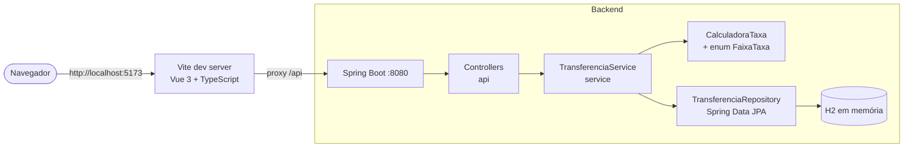
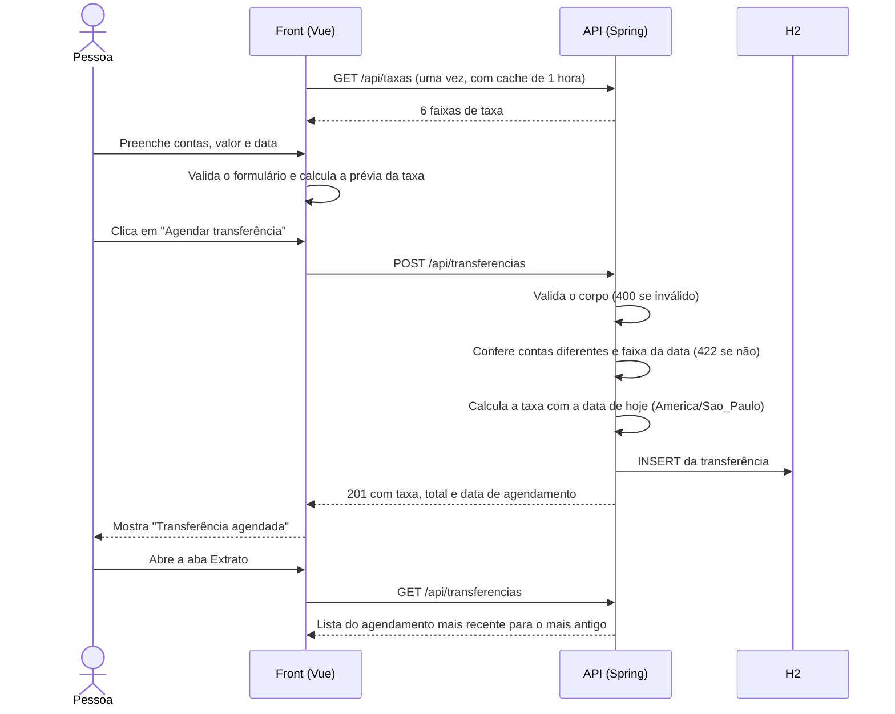
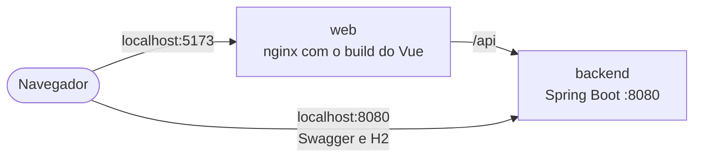

# Documentação do projeto

Esta pasta explica como o sistema foi construído. Para instalar e rodar, veja o [README da raiz](../README.md).

| Documento | Conteúdo |
| --- | --- |
| [Visão geral](#visão-geral) (esta página) | O que o sistema faz, como as partes conversam, o fluxo de um agendamento e o Docker |
| [API](api.md) | Contrato HTTP: rotas, corpos, códigos de status e formato dos erros |
| [Back-end](backend.md) | Pacotes, regra da taxa, validação, erros, persistência, testes e padrões de código |
| [Front-end](frontend.md) | Pastas, telas, estado, cliente HTTP, prévia da taxa, estilos e testes |

## Visão geral

O sistema agenda transferências financeiras entre duas contas de 10 dígitos. Quem agenda informa as contas, o valor e a data da transferência. A taxa depende de quantos dias faltam até essa data, e o agendamento só é aceito se houver uma faixa de taxa para ela. Todos os agendamentos aparecem em um extrato.

| Parte | Pasta | O que faz |
| --- | --- | --- |
| Back-end | `Backend/` | API REST em Spring Boot. Valida os dados, calcula a taxa, grava no H2 e devolve o extrato. É a fonte da verdade da taxa. |
| Front-end | `Web/` | Interface em Vue. Mostra a tabela de taxas, o formulário com a prévia da taxa e o extrato. |

## Arquitetura

- Em desenvolvimento, o front roda no Vite (porta 5173) e encaminha tudo que começa com `/api` para o back-end (porta 8080). Para o navegador é tudo a mesma origem, então não há configuração de CORS.
- Com Docker, o desenho é o mesmo, só que no lugar do Vite fica um nginx (veja [Docker](#docker)).
- O back-end não guarda estado fora do banco, e o banco é em memória: ao reiniciar a API os agendamentos somem.
- A tabela de faixas existe em um único lugar, o enum `FaixaTaxa` do back-end. O front a recebe por `GET /api/taxas`.

## Fluxo de um agendamento

A prévia do front é só para exibição. O valor gravado é sempre o que o servidor calcula, e o front mostra a taxa devolvida no `201`.

## Regra de negócio em uma página

| Regra | Onde é garantida |
| --- | --- |
| Contas com exatamente 10 dígitos | Bean Validation no back-end (400) e máscara e validação no front |
| Conta de destino diferente da de origem | `TransferenciaService` (422, com o campo `contaDestino`) e validação no front |
| Valor de R$ 0,01 até R$ 9.999.999.999.999,99, com 2 casas | Bean Validation no back-end (400) e validação no front, que formata em 2 casas |
| Data da transferência entre hoje e hoje + 50 dias | `CalculadoraTaxa` (422) e o seletor de data do front, limitado a essa faixa |
| Data de agendamento é sempre hoje | Definida pelo servidor, nunca enviada pelo cliente |
| Taxa pela faixa de dias, com 2 casas e HALF_EVEN | `CalculadoraTaxa` no back-end; o front repete a conta só para a prévia |

A tabela de faixas está em [backend.md](backend.md#regra-da-taxa).

## Docker

O `docker-compose.yml` da raiz sobe o projeto inteiro com `docker compose up --build`, sem Java nem Node na máquina.

| Serviço | Imagem | Como é montada |
| --- | --- | --- |
| `backend` | `Backend/Dockerfile` | Compila o jar com o Maven Wrapper numa imagem com JDK 11 e roda em outra só com o JRE 11, sem root |
| `web` | `Web/Dockerfile` | Roda `npm ci` e `npm run build` numa imagem Node 22 e entrega o `dist/` a um nginx |

- O nginx (`Web/nginx.conf`) faz o papel do proxy do Vite: encaminha `/api` para `http://backend:8080` e serve o resto como arquivos estáticos. Os arquivos de `assets/` têm hash no nome e vão com cache de um ano.
- O `backend` tem um healthcheck que chama `GET /api/taxas`, e o `web` só sobe quando ele passa. Assim a tela não abre antes da API.
- O `backend` roda com o profile `dev`, com o console do H2 liberado para acesso de fora do container.
- As portas podem ser trocadas com `WEB_PORT` e `API_PORT`, por exemplo num arquivo `.env` na raiz.

## Fora do escopo

Autenticação, saldo das contas, execução da transferência na data, edição ou cancelamento de agendamentos, paginação do extrato, banco persistente e deploy.
