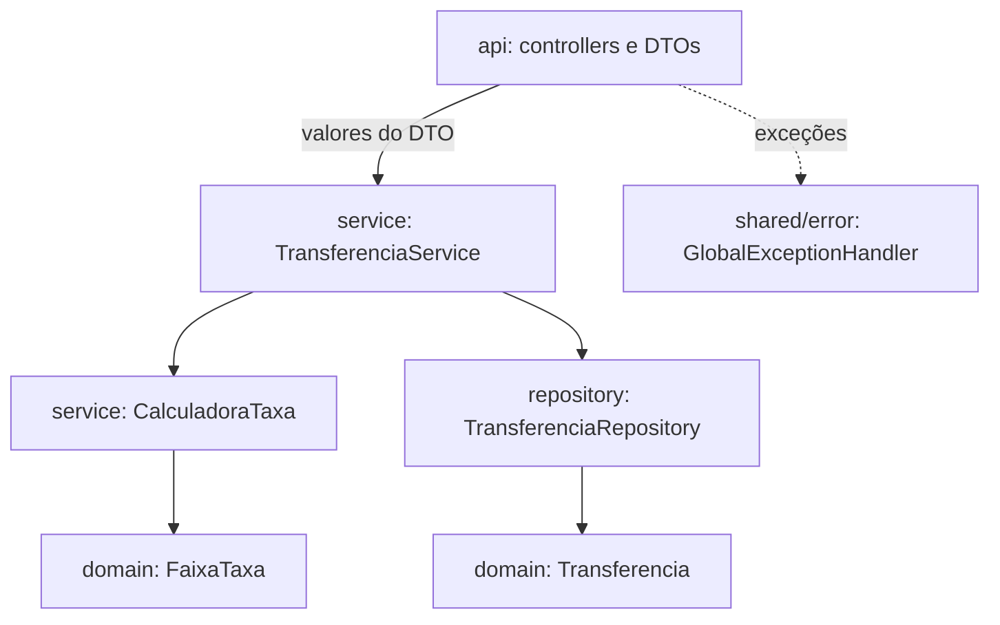

# Back-end

API REST em `Backend/`, no pacote `com.legado.testtecnico`. O contrato HTTP está em [api.md](api.md).

## Stack

| Item | Versão ou escolha | Por quê |
| --- | --- | --- |
| Java | 11 | Exigência do enunciado |
| Spring Boot | 2.7.18 | Última linha com suporte a Java 11 (a 3.x exige Java 17) |
| Persistência | Spring Data JPA + H2 em memória | Banco embutido, sem instalação |
| Validação | Bean Validation (`javax.validation`) | Regras de formato declaradas no DTO |
| Boilerplate | Lombok | Getters, construtores e builder sem código repetido |
| Documentação | springdoc-openapi 1.7.0 | Swagger UI compatível com Boot 2.7 |
| Testes | JUnit 5, Mockito, AssertJ, MockMvc | Vêm com `spring-boot-starter-test` |
| Build | Maven Wrapper (`mvnw`) | Não exige Maven instalado |

## Estrutura de pacotes

Os pacotes são por funcionalidade, com as camadas dentro de cada uma. É a mesma ideia do `features/` do front.

```
com.legado.testtecnico
├── TestTecnicoApplication.java
├── transferencia/
│   ├── api/
│   │   ├── TransferenciaController.java   POST, GET lista e GET por id
│   │   ├── TaxaController.java            GET /api/taxas
│   │   └── dto/
│   │       ├── TransferenciaRequest.java  entrada, com Bean Validation
│   │       ├── TransferenciaResponse.java saída da transferência
│   │       └── FaixaTaxaResponse.java     saída de uma faixa
│   ├── domain/
│   │   ├── Transferencia.java             entidade JPA
│   │   └── FaixaTaxa.java                 enum com a tabela de taxas
│   ├── service/
│   │   ├── TransferenciaService.java      casos de uso
│   │   └── CalculadoraTaxa.java           cálculo da taxa
│   └── repository/
│       └── TransferenciaRepository.java   Spring Data JPA
└── shared/
    ├── config/
    │   ├── ClockConfig.java               "hoje" no fuso de Brasília
    │   └── OpenApiConfig.java             título e descrição do Swagger
    └── error/
        ├── GlobalExceptionHandler.java    exceção → resposta HTTP
        ├── ErroResponse.java              corpo único de erro
        ├── RegraNegocioException.java     base das regras de negócio (422)
        ├── ContasIguaisException.java
        ├── TaxaNaoAplicavelException.java
        └── TransferenciaNaoEncontradaException.java
```

## Camadas



| Camada | Responsabilidade | O que não faz |
| --- | --- | --- |
| `api` | Recebe e valida o JSON, chama o serviço, monta a resposta e o `Location` | Não tem regra de negócio nem `try/catch`. A entidade nunca entra nem sai por aqui. |
| `service` | Regras de negócio, cálculo da taxa e transações | Não conhece HTTP |
| `domain` | Entidade e tabela de taxas | Não depende de Spring (só das anotações JPA) |
| `repository` | Acesso ao banco | Não tem SQL manual |
| `shared/error` | Converte toda exceção em `ErroResponse` com o status certo | |

## Modelo de dados

Uma tabela, `TRANSFERENCIA`, gerada pelo Hibernate a partir da entidade (`ddl-auto` padrão do H2 embutido, `create-drop`).

| Campo | Tipo Java | Coluna | Observação |
| --- | --- | --- | --- |
| `id` | `Long` | identity | gerado pelo banco |
| `contaOrigem` | `String` | `varchar(10)`, not null | texto para não perder zeros à esquerda |
| `contaDestino` | `String` | `varchar(10)`, not null | |
| `valor` | `BigDecimal` | `numeric(15,2)`, not null | |
| `taxa` | `BigDecimal` | `numeric(15,2)`, not null | calculada no servidor |
| `dataTransferencia` | `LocalDate` | `date`, not null | escolhida por quem agenda |
| `dataAgendamento` | `LocalDate` | `date`, not null | sempre "hoje", definida pelo servidor |

- `total` não é coluna: `Transferencia.getTotal()` devolve `valor + taxa`.
- A entidade só é criada pelo builder. O construtor sem argumentos é `protected`, só para o JPA, e não há setters.
- Não há tabela de contas: o enunciado só exige o formato de 10 dígitos.

## Regra da taxa

A tabela vive só no enum `FaixaTaxa`. O cálculo e o `GET /api/taxas` leem dele, então não existe número mágico em outro lugar.

| Faixa (enum) | Dias | Taxa fixa | Percentual | Rótulo |
| --- | --- | --- | --- | --- |
| `MESMO_DIA` | 0 | R$ 3,00 | 2,5% | Mesmo dia |
| `ATE_10_DIAS` | 1 a 10 | R$ 12,00 | 0,0% | 1 a 10 dias |
| `ATE_20_DIAS` | 11 a 20 | R$ 0,00 | 8,2% | 11 a 20 dias |
| `ATE_30_DIAS` | 21 a 30 | R$ 0,00 | 6,9% | 21 a 30 dias |
| `ATE_40_DIAS` | 31 a 40 | R$ 0,00 | 4,7% | 31 a 40 dias |
| `ATE_50_DIAS` | 41 a 50 | R$ 0,00 | 1,7% | 41 a 50 dias |

Passo a passo em `TransferenciaService.agendar`:

1. Recusa contas iguais com `ContasIguaisException` (422).
2. Pega "hoje" do `Clock` injetado: `LocalDate.now(clock)`.
3. Conta os dias com `ChronoUnit.DAYS.between(hoje, dataTransferencia)`.
4. `CalculadoraTaxa.calcular(dias, valor)` procura a faixa com `FaixaTaxa.paraDias(dias)`. Sem faixa (dias negativos ou acima de 50), lança `TaxaNaoAplicavelException` (422) e nada é gravado.
5. Calcula `taxaFixa + valor × percentual / 100` em `BigDecimal` e arredonda uma única vez, com `setScale(2, RoundingMode.HALF_EVEN)`.
6. Grava a transferência com `dataAgendamento = hoje` e registra no log.

Exemplos: R$ 1.000,00 daqui a 7 dias paga R$ 12,00. R$ 500,00 daqui a 15 dias paga R$ 41,00 (8,2%). R$ 100,00 hoje paga R$ 5,50 (3,00 + 2,5%).

### Por que um `Clock`

"Hoje" é o dia no Brasil, mesmo que o servidor esteja em UTC. Às 23h30 de Brasília já é o dia seguinte em UTC, e a conta de dias mudaria de faixa. O `ClockConfig` publica `Clock.system(America/Sao_Paulo)`, e os testes usam um `Clock.fixed`, o que deixa tudo determinístico.

## Validação e erros

São dois níveis, cada um com seu status:

| Nível | Onde | Status | Exemplos |
| --- | --- | --- | --- |
| Formato | Anotações no `TransferenciaRequest` (`@NotNull`, `@Pattern("\\d{10}")`, `@DecimalMin("0.01")`, `@Digits(13, 2)`) | 400 | conta com 9 dígitos, valor zero, campo ausente |
| Regra de negócio | Exceções que estendem `RegraNegocioException`, lançadas no serviço | 422 | contas iguais, data sem faixa de taxa |

O `GlobalExceptionHandler` estende `ResponseEntityExceptionHandler` e transforma tudo em `ErroResponse` (`{mensagem, campos}`):

| Exceção | Status | Corpo |
| --- | --- | --- |
| `MethodArgumentNotValidException` | 400 | `Erro: dados inválidos.` com a primeira mensagem de cada campo em `campos` |
| `HttpMessageNotReadableException` | 400 | mensagem sobre o corpo inválido e o formato `aaaa-mm-dd` |
| `RegraNegocioException` | 422 | a mensagem da exceção; quando ela aponta um campo, ele vai em `campos` |
| `TransferenciaNaoEncontradaException` | 404 | `Erro: transferência {id} não encontrada.` |
| Erros do Spring MVC (405, 415, tipo de parâmetro errado) | o da classe base | `Erro: a requisição não pôde ser processada.` |
| Qualquer outra `Exception` | 500 | mensagem genérica; o detalhe vai só para o log |

Para criar uma nova regra de negócio, basta estender `RegraNegocioException`, com ou sem campo, e lançar no serviço. O handler já responde 422.

## Persistência e transações

- `TransferenciaRepository` estende `JpaRepository`. A única consulta própria é o método derivado `findAllByOrderByDataAgendamentoDescIdDesc()`, que dá a ordem do extrato.
- `@Transactional` fica no serviço: escrita em `agendar`, `readOnly = true` em `buscarPorId` e `listarExtrato`.
- `spring.jpa.open-in-view=false`: a sessão do Hibernate não fica aberta durante a renderização da resposta.

## Configuração

| Arquivo | Conteúdo |
| --- | --- |
| `application.properties` | H2 em memória (`jdbc:h2:mem:agendamentodb`), `open-in-view=false`, erros sem stack trace e sem mensagem interna |
| `application-dev.properties` | Console do H2 em `/h2-console` e SQL no log. Liga com `-Dspring-boot.run.profiles=dev`. |

Nenhum valor de negócio fica nos arquivos de configuração.

## Testes

São 40 testes, que rodam com `./mvnw test`.

| Classe | Tipo | Testes | O que cobre |
| --- | --- | --- | --- |
| `CalculadoraTaxaTest` | Unitário, sem Spring | 16 | Todas as bordas de faixa (-1, 0, 1, 10, 11, 20, 21, 30, 31, 40, 41, 50, 51) e o arredondamento HALF_EVEN |
| `FaixaTaxaTest` | Unitário | 2 | Faixas cobrem de 0 a 50 dias sem buracos nem sobreposição; não há faixa fora disso |
| `TransferenciaServiceTest` | Mockito com `Clock` fixo | 5 | Grava com a taxa e a data de hoje; conta os dias no fuso do Brasil perto da meia-noite; não grava com data no passado nem com contas iguais; erro ao buscar um id inexistente |
| `TransferenciaRepositoryTest` | `@DataJpaTest` | 1 | Ordem do extrato |
| `TransferenciaControllerTest` | `@WebMvcTest` | 12 | 201 com `Location`, lista, busca, 400 (9 dígitos, valor zero, campos ausentes, JSON malformado, data fora do ISO), 422 (contas iguais, sem faixa), 404 e 500 sem detalhes |
| `TaxaControllerTest` | `@WebMvcTest` | 1 | Tabela de faixas e cabeçalho de cache |
| `AgendamentoIntegracaoTest` | `@SpringBootTest` | 2 | Agenda e aparece no extrato com a taxa do servidor; data além de 50 dias não grava |
| `TestTecnicoApplicationTests` | `@SpringBootTest` | 1 | O contexto sobe |

Convenções dos testes: nomes em português que descrevem o comportamento (`deveResponder422ComOCampoQuandoAsContasSaoIguais`), estrutura dado/quando/então, AssertJ com `isEqualByComparingTo` para `BigDecimal` e nenhuma dependência da data real.

## Padrões de código

**Nomes.** O domínio é em português (`Transferencia`, `contaOrigem`, `calcular`). Os papéis técnicos usam sufixos em inglês (`Controller`, `Service`, `Repository`, `Request`, `Response`, `Exception`, `Config`). Os pacotes são em minúsculas e não há abreviações.

**Valores.** Dinheiro é sempre `BigDecimal`, criado a partir de texto, e o arredondamento acontece num único ponto. As datas são `LocalDate`, e "hoje" vem sempre do `Clock`. Contas são `String`.

**Classes.** A injeção é só por construtor, com campos `final` (`@RequiredArgsConstructor`). O Lombok é usado com limite: nada de `@Data` ou `@EqualsAndHashCode` na entidade. Os DTOs de resposta são imutáveis e têm uma fábrica estática `de(...)`, sem biblioteca de mapeamento.

**Erros.** Controllers não têm `try/catch`. Toda mensagem ao usuário começa com "Erro:", e nenhuma resposta expõe stack trace.

**Higiene.** Indentação de 4 espaços, linhas de até 120 colunas, imports explícitos, log via SLF4J (`@Slf4j`) e `Optional` só como retorno.

## Decisões

| Decisão | Motivo |
| --- | --- |
| Taxa calculada no servidor, tabela servida em `GET /api/taxas` | O front mostra a prévia sem repetir a tabela, e o valor gravado tem uma fonte só |
| 400 para formato, 422 para regra de negócio | O cliente sabe se deve corrigir o formato ou escolher outro dado |
| Contas iguais é 422 com o campo `contaDestino` | É regra de negócio, mas o front ainda consegue marcar o campo |
| Sem valor máximo | O enunciado não pede; o limite é a precisão da coluna (13 inteiros e 2 casas) |
| H2 em memória sem Flyway | Uma tabela só, gerada pela entidade, é suficiente para o teste |
| Swagger com springdoc | Permite testar a API sem o front |
