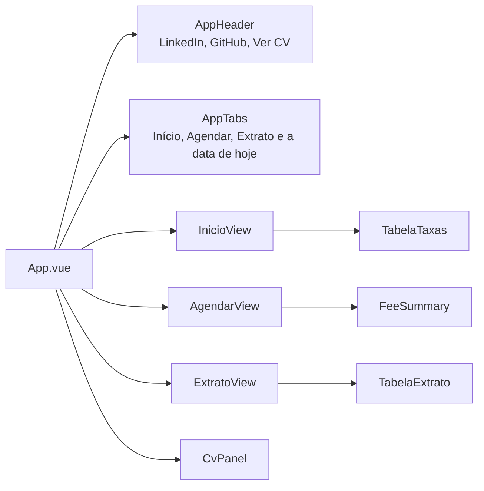

# Front-end

Interface em `Web/`, feita com Vue 3, TypeScript e Vite. Conversa com o back-end pelas rotas descritas em [api.md](api.md).

## Stack

| Item | Escolha |
| --- | --- |
| Framework | Vue 3 com `<script setup>` e Composition API |
| Linguagem | TypeScript |
| Build e servidor de desenvolvimento | Vite 8, com proxy de `/api` para `http://localhost:8080` |
| Testes | Vitest com jsdom e `@vue/test-utils` |
| Qualidade | `vue-tsc` (tipos), oxlint + ESLint e Prettier |
| Estado | Composables e `ref`/`reactive` do próprio Vue, sem Pinia |
| Navegação | Abas controladas por um `ref` no `App.vue`, sem vue-router |
| HTTP | `fetch` nativo encapsulado em `shared/api/http.ts`, sem axios |
| Estilos | CSS puro com tokens e classes `at-` do design system |

A única dependência de produção é o `vue`.

## Estrutura de pastas

As pastas são por funcionalidade (`features/`), com o que é compartilhado em `components/` e `shared/`. Os testes ficam em `__tests__/` ao lado do código que testam.

```
Web/src/
├── main.ts                     cria o app e importa os estilos
├── app/
│   ├── App.vue                 casca: cabeçalho, abas, conteúdo e painel do CV
│   └── styles/
│       ├── tokens.css          cores, espaçamentos, raios e fontes
│       ├── bundle.css          classes at- do design system
│       └── main.css            importa os dois e ajusta o body
├── components/
│   ├── layout/                 AppHeader, AppTabs, HeaderLink, PageContainer
│   └── ui/                     AppAlert, AppButton, TextField, MoneyField, DateField, icons/
├── features/
│   ├── inicio/                 InicioView, AppHero, TabelaTaxas
│   ├── agendamento/            AgendarView, FeeSummary, useAgendamento, agendamento.api
│   ├── extrato/                ExtratoView, TabelaExtrato, useExtrato, extrato.api
│   └── curriculo/              CvPanel, curriculo.ts (dados do autor)
└── shared/
    ├── api/http.ts             cliente HTTP e ErroApi
    ├── domain/                 faixasTaxa.ts (cálculo) e useFaixasTaxa.ts (tabela da API)
    ├── types/transferencia.ts  tipos do contrato da API
    ├── utils/                  datas.ts e formatters.ts
    └── config/autor.ts         links do LinkedIn e do GitHub
```

Regra de dependência: `features` usa `components` e `shared`; `components` usa só `shared`; `shared` não importa nada de cima. Uma feature não importa outra; quem junta todas é o `App.vue`. O alias `@` aponta para `src/`.

Cada feature segue o mesmo formato:

| Arquivo | Papel |
| --- | --- |
| `*View.vue` | Tela. Só monta componentes e liga eventos ao composable. |
| `use*.ts` | Composable com o estado e as regras da tela. É testável sem montar componente. |
| `*.api.ts` | Funções que chamam a API, uma por rota |
| Outros `.vue` | Partes da tela que só essa feature usa |

## Telas



O `App.vue` guarda a aba ativa num `ref<'inicio' | 'agendar' | 'extrato'>` e renderiza só a tela dela com `v-if`. Os botões da página inicial também trocam a aba e voltam a página ao topo. Como cada tela é montada de novo a cada visita, o extrato sempre busca os dados mais recentes.

### Início

Apresenta o sistema: o `AppHero` com chamadas para Agendar e Extrato, a `TabelaTaxas` com as faixas vindas de `GET /api/taxas`, os três passos de "Como funciona" e a lista da stack. Se a tabela não carregar, aparece um aviso com a opção de tentar de novo.

### Agendar

Formulário com conta de origem, conta de destino, valor, data da transferência e a data de agendamento (hoje, só leitura). Enquanto a pessoa preenche, o `FeeSummary` mostra a faixa, a taxa fixa, o percentual, a taxa calculada e o total a debitar.

| Situação | O que a tela faz |
| --- | --- |
| Conta com menos de 10 dígitos | Mostra o erro quando a pessoa sai do campo. A máscara já aceita só dígitos, até 10. |
| Contas iguais | Mostra o erro na conta de destino assim que as duas estão completas |
| Valor zero | Mostra o erro quando a pessoa sai do campo |
| Valor acima de R$ 9.999.999.999.999,99 | Mostra o erro na hora. O teto é o mesmo do back-end e fica em `VALOR_MAXIMO`, em `useAgendamento.ts`. |
| Data sem faixa de taxa | Esconde o resumo e mostra "Erro: não há taxa aplicável". O seletor de data já vai só de hoje até hoje + 50 dias. |
| Tabela de taxas não carregou | Mostra o erro com "Tentar de novo"; sem a tabela não há prévia |
| Formulário incompleto ou inválido | O botão "Agendar transferência" fica desabilitado |
| Envio em andamento | O botão mostra "Agendando..." e fica desabilitado |
| Erro do servidor | Mostra a mensagem da API e marca os campos que vieram em `campos` |
| Sucesso | Mostra "Transferência agendada" com o valor, a conta, a data e a taxa devolvidos pela API. Limpa destino e valor, e mantém origem e data para o próximo agendamento. |

Qualquer edição tira da tela o resultado e os erros do envio anterior. O botão "Limpar" zera o formulário.

### Extrato

Busca `GET /api/transferencias` ao abrir e mostra a `TabelaExtrato` com origem, destino, valor, taxa, data da transferência e data de agendamento, mais a contagem ("3 agendamentos"). Enquanto carrega, mostra "Carregando o extrato...". Em caso de erro, mostra o alerta com "Tentar de novo". Sem agendamentos, a tabela diz "Nenhuma transferência agendada ainda."

### Painel do CV

O botão "Ver CV" do cabeçalho abre o `CvPanel`, um painel lateral com os dados de `features/curriculo/curriculo.ts`. Ele fecha com o botão "Fechar" ou com Esc, e o foco vai para o botão ao abrir.

## Estado e composables

| Composable | Estado | Observação |
| --- | --- | --- |
| `useFaixasTaxa` | `faixas`, `carregando`, `erro`, `recarregar` | Estado de módulo, compartilhado por todas as telas. A tabela é pedida uma vez só; uma falha libera um novo pedido. |
| `useAgendamento` | formulário, campos tocados, erros, prévia (`faixa`, `taxa`, `total`), `podeAgendar`, `enviando`, `agendada` | Concentra toda a regra da tela Agendar |
| `useExtrato` | `transferencias`, `carregando`, `erro`, `quantidade` | Começa em `carregando` para não piscar "nenhuma transferência" antes da resposta. Reordena por data de agendamento e id, por garantia. |

Os erros de campo vêm de duas fontes, nesta ordem: a validação local, que só aparece depois que a pessoa sai do campo, e os erros que o servidor devolveu em `campos`, que somem quando a pessoa edita.

## Cliente HTTP e erros

`shared/api/http.ts` expõe `getJson` e `postJson`. Os dois mandam e aceitam JSON e lançam `ErroApi` em qualquer falha:

```ts
class ErroApi extends Error {
  status: number                  // 0 quando não houve resposta
  campos: Record<string, string>  // erros por campo, quando a API manda
}
```

| Situação | `message` | `status` |
| --- | --- | --- |
| Sem conexão com o servidor | `Erro: não foi possível falar com o servidor. Tente de novo em instantes.` | 0 |
| Resposta de erro com `{mensagem, campos}` | a `mensagem` da API | o da resposta |
| Resposta de erro sem corpo JSON | `Erro: o servidor não conseguiu concluir o pedido. Tente de novo.` | o da resposta |

Toda mensagem é garantida com o prefixo "Erro:". As telas mostram `erro.message` num `AppAlert` e repassam `erro.campos` aos campos do formulário.

## Prévia da taxa

O front não tem a tabela de taxas no código. Ela vem de `GET /api/taxas`, e `shared/domain/faixasTaxa.ts` só faz a conta:

| Função | O que faz |
| --- | --- |
| `encontrarFaixa(faixas, dias)` | Devolve a faixa que contém os dias, ou `null` |
| `diasMaximos(faixas)` | Maior `diasAte` da tabela (hoje, 50). Limita o seletor de data. |
| `calcularTaxa(valor, faixa)` | `taxaFixa + valor × percentual / 100`, arredondado em centavos com HALF_EVEN |

O arredondamento HALF_EVEN foi reproduzido à mão para coincidir com o `BigDecimal` do back-end, inclusive nos meios centavos. Mesmo assim, a prévia é só exibição: o valor gravado e mostrado após o envio é o que a API devolve.

Os dias são contados por `diasEntre(hoje, data)` em `shared/utils/datas.ts`, que compara as datas em UTC para não errar em dias de horário de verão.

## Datas e formatação

- As datas trafegam como texto ISO (`aaaa-mm-dd`), o mesmo formato do `<input type="date">` e da API. `datas.ts` tem `hojeISO`, `somarDias`, `diasEntre` e `formatarDataISO` (para `dd/mm/aaaa`).
- `formatters.ts` usa `Intl` em `pt-BR`: `formatarMoeda` (R$), `formatarPercentual` (uma casa, com %), `formatarData` e o par `formatarValorCampo`/`lerValor`, usado pelo `MoneyField` para aceitar "1.000,50" e guardar `1000.5`.

## Componentes de UI

| Componente | Uso |
| --- | --- |
| `TextField` | Campo de texto com rótulo, ajuda, erro e uma função de máscara opcional |
| `MoneyField` | Valor em reais no padrão brasileiro. O `v-model` é um número; o texto é formatado ao sair do campo. |
| `DateField` | Seletor de data nativo com `min` e `max`, ou texto formatado no modo somente leitura |
| `AppButton` | Botões `primary` e `secondary` |
| `AppAlert` | Alertas `danger`, `success` e `info`. `danger` usa `role="alert"`; os outros, `role="status"`. |

`TextField` e `MoneyField` emitem `blur`, que a tela usa para marcar o campo como tocado.

## Estilos e design system

- `tokens.css` define as variáveis do design system em `:root`: cores (`--wine-700`, `--ink`, `--danger`, `--success`...), espaçamentos (`--space-1` a `--space-8`), raios, sombra e fontes.
- `bundle.css` traz as classes prontas do design system, todas com o prefixo `at-`: `at-header`, `at-tabs`, `at-hero`, `at-card`, `at-field`, `at-btn`, `at-fee`, `at-alert`, `at-table`, `at-steps`, `at-chips` e outras.
- Os componentes usam essas classes, e o que é específico de uma tela fica em `<style scoped>` usando só as variáveis dos tokens.
- As fontes (IBM Plex Sans e Source Serif 4) vêm do Google Fonts, no `index.html`.

## Acessibilidade

- As abas usam `role="tablist"`, `role="tab"` e `aria-selected`.
- O resumo da taxa é `aria-live="polite"`, então leitores de tela anunciam a mudança da taxa.
- Os erros usam `role="alert"`, e o carregamento, `role="status"`.
- O painel do CV é um `role="dialog"` que recebe o foco ao abrir e fecha com Esc.

## Testes

São 20 arquivos de teste, um ao lado de cada parte com lógica. Os composables são testados sem montar componente, e as telas com `@vue/test-utils`. A API é simulada com `vi.mock` (no `http.spec.ts`, o próprio `fetch`), e a data é fixada com `vi.setSystemTime` onde "hoje" importa.

| Pasta | Arquivos |
| --- | --- |
| `app/` | `App.spec.ts` |
| `components/layout/` | `AppHeader`, `AppTabs`, `HeaderLink` |
| `components/ui/` | `AppButton`, `MoneyField`, `TextField` |
| `features/agendamento/` | `AgendarView`, `useAgendamento` |
| `features/extrato/` | `ExtratoView`, `TabelaExtrato`, `useExtrato` |
| `features/inicio/` | `InicioView`, `TabelaTaxas` |
| `features/curriculo/` | `CvPanel` |
| `shared/` | `http`, `faixasTaxa`, `useFaixasTaxa`, `datas`, `formatters` |

## Scripts

| Comando | O que faz |
| --- | --- |
| `npm run dev` | Servidor de desenvolvimento em http://localhost:5173 |
| `npm run build` | Checa os tipos com `vue-tsc` e gera o build em `dist/` |
| `npm run preview` | Serve o build de produção |
| `npm run test:unit` | Vitest em modo observação; com `-- --run`, roda uma vez |
| `npm run lint` | oxlint e ESLint, com correção automática |
| `npm run format` | Prettier em `src/` |

O Node precisa ser 22.18 ou mais novo, como diz o campo `engines` do `package.json`.
